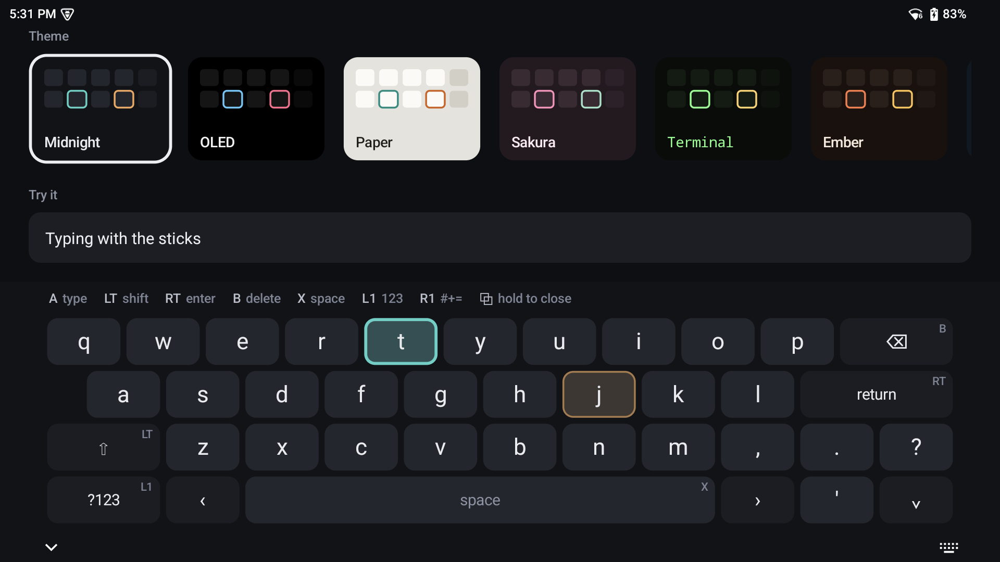
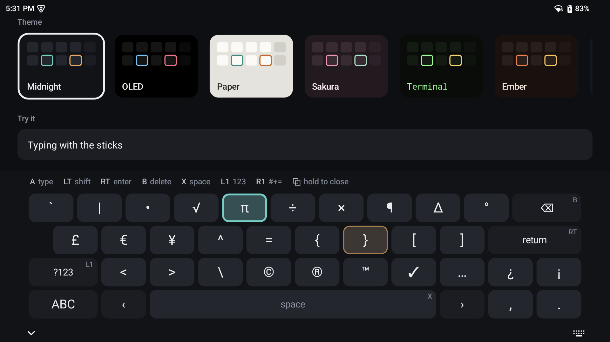
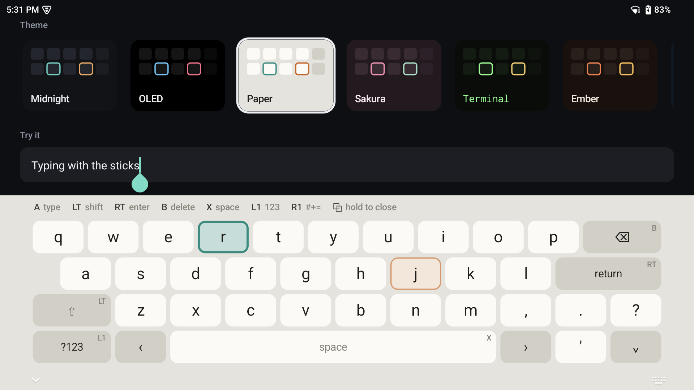
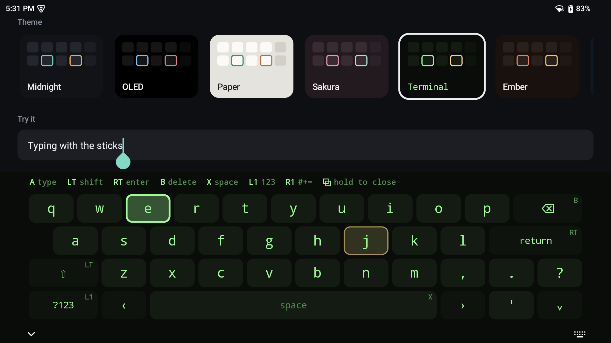
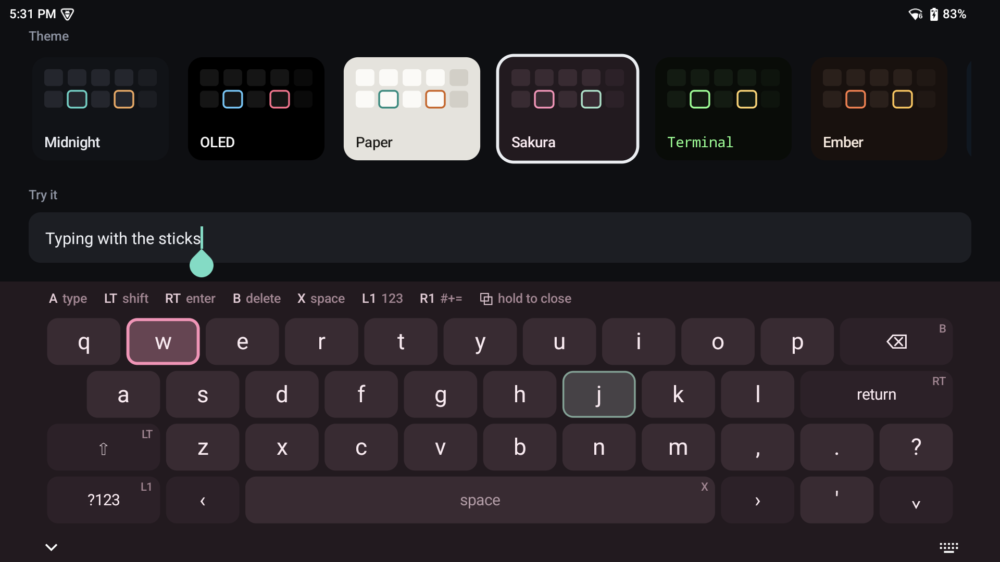
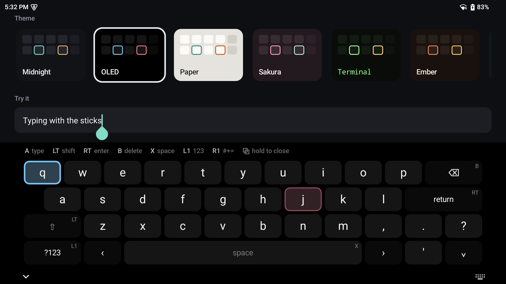
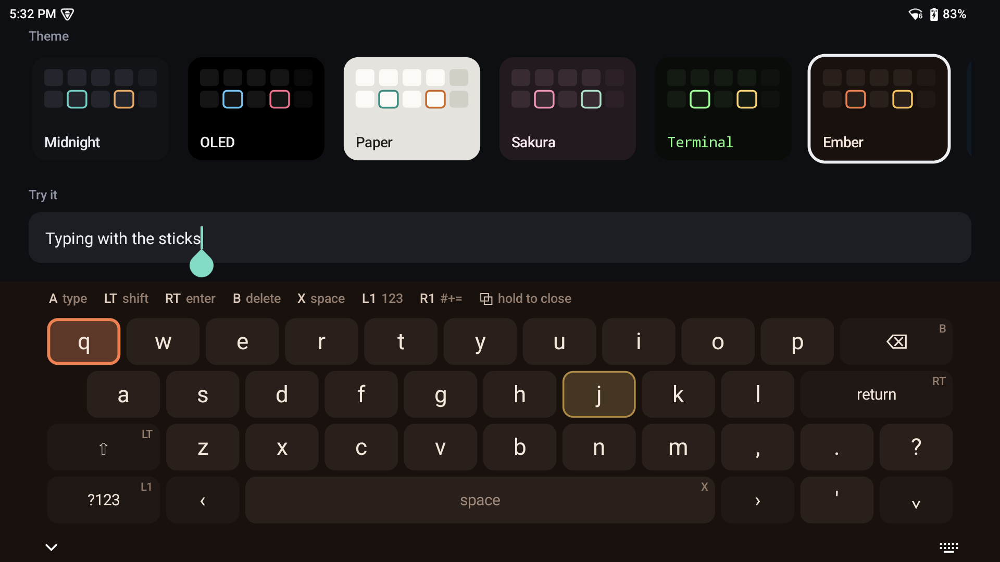
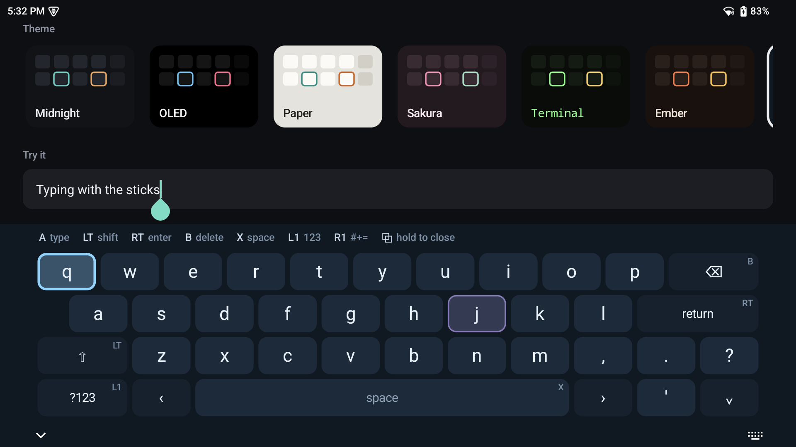
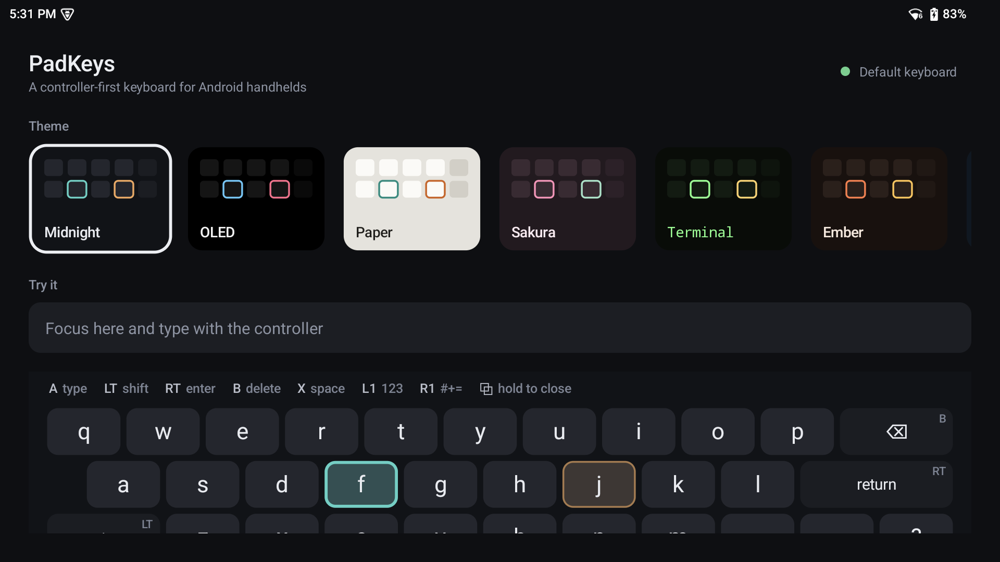

# PadKeys

An Android keyboard you can type on with a gamepad. Built for handhelds with built-in controllers, like the AYN Odin and Thor and the Retroid Pocket, and it works with any Android device that has a controller connected. Touch still works too.

There are two cursors, one per stick, so you can type with both thumbs the way you would on a Steam Deck. The sticks and d-pad move key by key. They don't drag a mouse pointer around.



## Controls

| Input | Action |
| --- | --- |
| Left stick | Move the left (teal) cursor one key at a time. Hold to repeat; tilt further to go faster |
| Right stick | Move the right (amber) cursor the same way |
| D-pad | Move whichever cursor you used last |
| A | Type the key under the cursor you used last |
| L3 / R3 (stick click) | Type the key under that stick's cursor |
| B | Delete (hold to repeat; it speeds up after a second) |
| X | Space |
| LT | Shift (pull twice quickly for caps lock) |
| RT | Enter, or the field's action (Send, Search, Go, ...) |
| L1 | Numbers and symbols page (press again for letters) |
| R1 | More symbols page (press again for letters) |
| Select | Short press: numbers page. Hold: close the keyboard |
| Y / Start | Also shift / enter |

Both cursors can move across the whole keyboard. Keys that have a controller shortcut show it in their corner, and a strip above the keys lists the main buttons.

While the keyboard is open it takes controller input, so the app underneath doesn't get it. Back and Home still reach the system. Once the keyboard closes, your controller goes back to the game or app.

| Numbers (L1) | More symbols (R1) |
| --- | --- |
|  |  |

## Themes

Open the PadKeys app and pick a theme. The preview updates as soon as you pick one, and the keyboard uses it the next time it opens. There are seven: Midnight, OLED, Paper, Sakura, Terminal, Ember and Glacier.

| | |
| --- | --- |
|  |  |
|  |  |
|  |  |

To add your own theme, add a `KeyboardTheme` to [`Themes.kt`](app/src/main/java/com/kamaal/padkeys/keyboard/Themes.kt).



## Install

Requires Android 12 (API 31) or newer.

**From a release:** download the APK from [Releases](../../releases), install it, open **PadKeys** and tap **Enable**, then **Set as default**.

**From source** with the device connected over adb:

```sh
scripts/install.sh   # builds, installs, enables and selects PadKeys
```

The script needs JDK 21 (`brew install openjdk@21` on macOS) and the Android SDK with platform 35. If more than one device is connected, set `ANDROID_SERIAL`.

To go back to Gboard, run `scripts/restore-ime.sh` or switch keyboards in Android settings.

## Remapping

All button bindings and timings (stick thresholds, repeat delays, long-press length) are in [`ControllerBindings.kt`](app/src/main/java/com/kamaal/padkeys/input/ControllerBindings.kt). Layouts are in [`Layouts.kt`](app/src/main/java/com/kamaal/padkeys/keyboard/Layouts.kt).

## How it works

- `ime/PadKeysImeService.kt` is the `InputMethodService`. It handles shift, caps lock and auto-capitalisation, and edits the text field: committing text, deleting without splitting emoji, and performing editor actions.
- `input/GamepadController.kt` gets button presses in `onKeyDown`/`onKeyUp` and stick and trigger movement in `onGenericMotionEvent`. Each stick is treated as a 4-way d-pad with hysteresis, and triggers fire once per pull even when the controller reports a pull as both a button press and an axis movement.
- `keyboard/KeyboardView.kt` is a single custom `View` that draws the keyboard and both cursors and handles touch.

## Development

```sh
./gradlew :app:assembleDebug :app:lintDebug
python3 scripts/screenshots.py   # regenerate docs/screenshots on a connected device
```

## License

[MIT](LICENSE)
